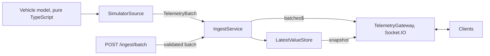

# PRD: Week 2 — Simulator and Ingest Pipeline

| Field | Value |
| --- | --- |
| Project | SokilGCS |
| Status | Draft |
| Date | 2026-10-16 |
| Scope | `apps/backend` (plus `.env.example`, Dockerfile and `docker-compose.yml` changes) |
| Depends on | Week 1: contracts (telemetry, alarm and command schemas), test runner, CI |
| Enables | Week 3 MAVLink adapter, week 4 frontend, week 5 limits and alarms, week 6 recording |

## 1. Summary

Build the first end-to-end telemetry path: a simulated vehicle produces telemetry, the backend ingests it, and any connected client receives it in real time over WebSocket. External sources (a future RC-car tracker) can push the same data through an authenticated HTTP endpoint.

The goal is to prove the data model and the pipeline shape. Every later week plugs into the pieces built here.

## 2. Goals and non-goals

### Goals

- **G1.** A deterministic, vehicle-agnostic simulator emits `TelemetryBatch` messages at 10 Hz.
- **G2.** One ingest entry point accepts batches from any source and publishes them to subscribers.
- **G3.** The backend keeps the latest value of every channel and sends it to clients when they connect.
- **G4.** A WebSocket gateway streams batches to clients with a documented message protocol.
- **G5.** External data enters through one validated, authenticated HTTP endpoint.
- **G6.** The backend runs in a container and works with the same behavior as local development.

### Non-goals

- Persistence in PostgreSQL (week 6).
- MAVLink or any real vehicle (week 3).
- Limit evaluation and alarms (week 5). Week 2 only publishes limit metadata.
- Frontend work (week 4).
- User accounts, roles or per-client WebSocket authentication.
- Multiple simultaneous sessions or multiple backend instances (so no Redis).

## 3. Users and scenarios

| ID | User | Scenario |
| --- | --- | --- |
| U1 | Developer | Starts the backend, runs the listener script and sees live telemetry in the terminal. |
| U2 | Frontend client (week 4) | Connects, receives the session description and the current values, then a live stream. |
| U3 | External source (later) | Posts a `TelemetryBatch` with a token and sees it appear in the stream. |

## 4. Prerequisites (Step 0)

- [ ] `@sokil/contracts` builds and the backend can import its telemetry types (`@sokil/contracts/telemetry`, or the package root if the subpath does not resolve).
- [ ] The backend `tsconfig.json` has no `paths` entry pointing at `../packages/contracts/dist`; workspace resolution is used instead. `pnpm --filter @sokil/backend check-types` passes.
- [ ] Jest is configured in the backend (`ts-jest`, `rootDir: src`, `.spec.ts` files) with a `"test"` script. `@nestjs/testing` is `^10.3.0`.
- [ ] `zod` uses the same range (`^4.6.5`) in every package; `pnpm why zod` shows one version.
- [ ] `socket.io-client` is a backend dev dependency.
- [ ] The ESLint rule that keeps the math core free of framework imports covers `src/domain/**/*.ts`, not only `src/domain/math`.

## 5. Architecture



```text
apps/backend/
  scripts/ws-listen.ts
  src/
    config/env.ts
    domain/
      math/geo.ts            (+ geo.spec.ts)
      math/prng.ts           (+ prng.spec.ts)
      simulator/vehicle-model.ts   (+ vehicle-model.spec.ts)
    telemetry/
      channels.ts
      session.service.ts
      latest-values.store.ts (+ spec)
      ingest.service.ts      (+ spec)
      ingest.controller.ts
      ingest-token.guard.ts  (+ spec)
      dto/telemetry-batch.dto.ts
      sources/telemetry-source.ts
      sources/simulator.source.ts
      gateway/telemetry.gateway.ts
      telemetry.module.ts
```

Design decisions fixed for this week:

- **One in-memory session** per process start.
- **Latest values** live in an in-memory `Map`.
- **Validation** happens at the HTTP boundary only. The simulator runs in-process and is not re-validated.
- **Socket.IO** is kept, because the project already depends on `@nestjs/platform-socket.io`.

## 6. Functional requirements

Priority: **M** = must, **S** = should.

### 6.1 Geo and random helpers (`domain/math`)

| ID | Requirement | Pri |
| --- | --- | --- |
| FR-G1 | `geo.ts` exports `offsetLatLon(lat0, lon0, eastM, northM)` using a spherical Earth, radius 6,371,008.8 m (about 111,195 m per degree of latitude). Longitude scaling uses `cos(lat0)`. | M |
| FR-G2 | `geo.ts` exports `haversineM(a, b)` for tests and later use. | M |
| FR-G3 | `prng.ts` exports a seeded generator (mulberry32) and `hashSeed(...parts: Array<number \| string>)` that returns a 32-bit seed. | M |
| FR-G4 | Neither file imports `@nestjs/*`, `rxjs`, Node I/O or uses `Math.random` or `Date.now`. | M |

### 6.2 Vehicle model (`domain/simulator`)

| ID | Requirement | Pri |
| --- | --- | --- |
| FR-M1 | `createVehicleModel(config)` returns `{ samplesAt(tickIndex: number, timestampMs: number): TelemetrySample[] }`. It is a pure function of its arguments. | M |
| FR-M2 | Config: `center {lat, lon}` (default 34.2045, -118.1723), `radiusM` (150), `speedMps` (4), `batteryStartV` (25.0), `batteryEndV` (20.8), `batteryDrainSeconds` (600), `seed` (42). The tick rate is fixed at 10 Hz (100 ms per tick). | M |
| FR-M3 | Track: at tick `n`, elapsed `t = n × 0.1 s`, angle `θ = (speed / radius) × t` measured clockwise from north. `east = r·sin θ`, `north = r·cos θ`. Heading is `(θ in degrees + 90) mod 360`. | M |
| FR-M4 | Battery voltage falls linearly from start to end over `batteryDrainSeconds`, then stays at the end value. Voltage current is `18.6 A ± 0.5`. | M |
| FR-M5 | Noise is uniform within a fixed amplitude and is a pure function of `(seed, channelId, tickIndex)`. The result does not depend on call order. | M |
| FR-M6 | Each channel is emitted only on ticks that match its nominal rate (10, 5, 2 and 1 Hz). Every tick contains at least one sample. | M |
| FR-M7 | All values are finite numbers and satisfy the channel's `valueType`. | M |

### 6.3 Channel catalog (`telemetry/channels.ts`)

| ID | Requirement | Pri |
| --- | --- | --- |
| FR-C1 | `SIMULATOR_CHANNELS` contains the channels below. Each entry is checked with `ChannelDefinitionSchema` at module load; an invalid entry fails startup. | M |

| Channel ID | Name | Unit | Rate | redLow | yellowLow | yellowHigh | redHigh | Simulated value |
| --- | --- | --- | --- | --- | --- | --- | --- | --- |
| `position.lat` | Latitude | deg | 10 Hz | | | | | circle, see FR-M3 |
| `position.lon` | Longitude | deg | 10 Hz | | | | | circle, see FR-M3 |
| `nav.groundspeed` | Ground speed | m/s | 10 Hz | | | 5.0 | 6.0 | 4.0 ± 0.1 |
| `nav.heading` | Heading | deg | 10 Hz | | | | | tangent ± 0.5 |
| `battery.voltage` | Battery voltage | V | 10 Hz | 21.2 | 21.8 | 25.2 | 25.8 | 25.0 → 20.8, ± 0.02 |
| `battery.current` | Battery current | A | 10 Hz | | | | | 18.6 ± 0.5 |
| `gps.satellites` | GPS satellites | count | 1 Hz | 6 | 10 | | | 18 ± 1 (integer) |
| `gps.hdop` | GPS HDOP | none | 5 Hz | | | 1.8 | 2.5 | 0.9 ± 0.15 |
| `link.rssi` | Link RSSI | dBm | 2 Hz | -95 | -85 | | | -68 ± 3 |

With the default drain, the voltage passes the yellow limit (21.8 V) at about 457 s and the red limit (21.2 V) at about 543 s, so week 5 has something to alarm on. `batteryDrainSeconds` can be lowered for demos.

### 6.4 Session

| ID | Requirement | Pri |
| --- | --- | --- |
| FR-S1 | `SessionService` holds at most one active `Session`. When the simulator is enabled it creates one at startup: UUID, name `Simulator run <ISO time>`, `sourceKind: SIMULATOR`, `vehicleKind: ROVER`, `startedAt`, and `SIMULATOR_CHANNELS`. It is checked with `SessionSchema`. | M |
| FR-S2 | `GET /sessions/active` returns the session as JSON, or 404 when there is none. | S |

### 6.5 Telemetry source

| ID | Requirement | Pri |
| --- | --- | --- |
| FR-SRC1 | `TelemetrySource` interface: `id: string`, `start(): void`, `stop(): void`. A source delivers data by calling `IngestService.ingest(batch)`. | M |
| FR-SRC2 | `SimulatorSource` implements it. It schedules tick `n` for `startMs + n × 100` and corrects for timer drift. The sample time `t` is the scheduled time, not the time the callback ran. | M |
| FR-SRC3 | It starts on module init when `SIMULATOR_ENABLED=true` and stops cleanly on module destroy (no timers left running). | M |
| FR-SRC4 | Each batch carries the active session ID and `sourceId: "simulator"`. | M |

### 6.6 Ingest service and latest-value store

| ID | Requirement | Pri |
| --- | --- | --- |
| FR-I1 | `IngestService.ingest(batch)` updates the store and then publishes the batch on `batches$` (an RxJS `Subject`, no replay buffer). | M |
| FR-I2 | `LatestValueStore.update(batch)` keeps, per channel, the sample with the highest `t`. A sample with a lower `t` than the stored one is ignored by the store, but the batch is still published. Equal `t` replaces the stored sample. | M |
| FR-I3 | `snapshot()` returns the latest sample of every channel that has received data. | M |
| FR-I4 | The store's size is bounded by the number of channels. | M |

### 6.7 HTTP ingest endpoint

`POST /ingest/batch`, body: `TelemetryBatch` JSON.

| ID | Requirement | Pri |
| --- | --- | --- |
| FR-H1 | The token guard runs before body validation. The `x-api-key` header is compared with `INGEST_TOKEN` in constant time (hash both values with SHA-256, then `timingSafeEqual`). | M |
| FR-H2 | The body is validated with `TelemetryBatchSchema` through a `createZodDto` class defined in the backend. | M |
| FR-H3 | Semantic checks after schema validation: the batch `sessionId` equals the active session, every `channelId` exists in the session, and each value matches its channel's `valueType`. | M |
| FR-H4 | Body size limit is 1 MB. | M |
| FR-H5 | If `INGEST_TOKEN` is not set, the endpoint answers 503 and a warning is logged at startup. | M |

| Status | Meaning | Body |
| --- | --- | --- |
| 202 | Batch accepted | `{ "accepted": <sample count> }` |
| 400 | Schema validation failed | `{ statusCode, message, errors: [...] }` (Zod issues) |
| 401 | Missing or wrong token | `{ statusCode, message }`, no validation details |
| 404 | `sessionId` is not the active session | `{ statusCode, message }` |
| 413 | Body larger than 1 MB | default error body |
| 422 | Unknown channel or wrong value type | `{ statusCode, message, errors: [{ index, channelId, reason }] }` |
| 503 | Endpoint disabled (no token configured) | `{ statusCode, message }` |

### 6.8 WebSocket gateway

Socket.IO namespace `/`, CORS origin from `WEB_ORIGIN` (default `http://localhost:3000`).

| ID | Requirement | Pri |
| --- | --- | --- |
| FR-W1 | On connection the server sends, in this order: `session`, then `snapshot`. Both are sent to that client only. | M |
| FR-W2 | The client joins the room `session:<activeSessionId>`. | M |
| FR-W3 | Every published batch is sent to that room as a `batch` event, using `volatile` emit so a slow client does not accumulate a backlog. | M |
| FR-W4 | With no active session, the server sends `session` with `null` and no snapshot. | M |
| FR-W5 | The gateway keeps no per-client state beyond the room membership. | M |

| Event | Direction | Payload |
| --- | --- | --- |
| `session` | server to client | `Session` or `null` |
| `snapshot` | server to client | `{ sessionId: string, samples: TelemetrySample[] }` |
| `batch` | server to client | `TelemetryBatch` |

### 6.9 Configuration, operations and container

| ID | Requirement | Pri |
| --- | --- | --- |
| FR-O1 | `config/env.ts` reads and validates environment variables with Zod at startup; invalid configuration stops the app with a readable message. | M |
| FR-O2 | Logging uses the Nest `Logger`, not `console.log`. Log session start, client connect and disconnect, rejected ingest requests (warn level) and a batches-per-second counter every 10 s (debug). The token is never logged. | M |
| FR-O3 | `GET /health` returns `{ status: "ok", simulator: "running" \| "stopped" }`. | S |
| FR-O4 | `scripts/ws-listen.ts` connects with `socket.io-client` and prints each event type and a count of batches per second. | M |
| FR-O5 | The backend Dockerfile builds `@sokil/contracts` before the backend; `.dockerignore` excludes `node_modules`, `dist` and `.env`. | M |
| FR-O6 | In `docker-compose.yml`, the backend port is bound to `127.0.0.1` (`127.0.0.1:3001:3000`). The backend uses `PORT` (3000 in the container, 3001 for local development, so the frontend's `NEXT_PUBLIC_WS_URL` is the same in both modes). | M |

| Variable | Default | Purpose |
| --- | --- | --- |
| `PORT` | 3000 | HTTP and WebSocket port |
| `WEB_ORIGIN` | `http://localhost:3000` | Allowed CORS origin |
| `SIMULATOR_ENABLED` | `true` | Start the simulator |
| `SIMULATOR_SEED` | `42` | Noise seed |
| `SIMULATOR_BATTERY_DRAIN_SECONDS` | `600` | Time from start to end voltage |
| `INGEST_TOKEN` | none | HTTP ingest token; no default |

Add all of them to `.env.example` (the token as a placeholder, never a real value).

## 7. Non-functional requirements

| ID | Requirement |
| --- | --- |
| NFR-1 | Over any 60 s window with the simulator running, 600 ± 2 batches are published. |
| NFR-2 | Sample times are exact: the `t` of consecutive simulator batches differs by exactly 100 ms. |
| NFR-3 | Timer scheduling error (callback start vs scheduled time) and the time from `ingest()` to socket emit are measured locally and logged in the e2e test. They are not asserted in CI, to avoid flaky tests. Target: p95 under 20 ms and 10 ms. |
| NFR-4 | Memory does not grow over a 10-minute run (the store is bounded, no replay buffers). |
| NFR-5 | `lint`, `check-types`, `test` and `build` pass in CI. `domain/**` has no framework imports. No import cycles. No `console.log` in `src`. |
| NFR-6 | Security: constant-time token comparison, no secrets in logs, a CORS origin allowlist, a body size limit. |
| NFR-7 | Invalid input to the HTTP endpoint never crashes the process and never changes the store. |

## 8. Acceptance criteria

- **AC-1.** With the simulator enabled, `ws-listen.ts` shows `session`, then `snapshot`, then about 10 `batch` events per second.
- **AC-2.** Positions in the batches stay within 0.5 m of the 150 m radius around the center, and one lap takes about 235.6 s.
- **AC-3.** `battery.voltage` decreases over time and reaches the red limit at about 543 s with the default config.
- **AC-4.** A client that connects 30 s after startup receives a snapshot with the latest value of all nine channels.
- **AC-5.** Two backend runs with the same seed produce identical sample values for identical tick indexes.
- **AC-6.** `POST /ingest/batch` without a token returns 401; with a wrong token, 401; with no `INGEST_TOKEN` configured, 503.
- **AC-7.** A valid batch with the right token returns 202, and an attached client receives it as a `batch` event.
- **AC-8.** A batch missing required fields returns 400 with an `errors` list. A batch with an unknown channel returns 422. A batch for another `sessionId` returns 404.
- **AC-9.** A sample older than the stored value for its channel does not change the snapshot but is still delivered as part of its batch.
- **AC-10.** Stopping the app leaves no running timer (Jest exits without the "open handles" warning).
- **AC-11.** `docker compose --profile app up --build` starts the backend, and `ws-listen.ts` against `localhost:3001` shows the same stream as in local development.
- **AC-12.** CI is green on the pull request.

## 9. Test plan

| Level | What | File |
| --- | --- | --- |
| Unit | Distance from center equals the radius; one lap returns to the start; heading is tangent; the same seed gives the same output; the voltage 10 s later is lower (default config); channel IDs pass `ChannelIdSchema`; channel rates match FR-M6 | `vehicle-model.spec.ts` |
| Unit | Offset and haversine round trip; PRNG is deterministic and in `[0, 1)` | `geo.spec.ts`, `prng.spec.ts` |
| Unit | Store keeps the newest sample, ignores older ones, replaces equal times, and `snapshot()` is correct | `latest-values.store.spec.ts` |
| Unit | Ingest publishes every batch, even when the store ignores a sample | `ingest.service.spec.ts` |
| Unit | Guard accepts the right token and rejects wrong, missing and different-length tokens | `ingest-token.guard.spec.ts` |
| Integration | HTTP: 202, 400, 401, 404, 413, 422, 503 | `ingest.e2e-spec.ts` |
| Integration | Socket: event order `session`, `snapshot`, `batch`; the count of batches over 2 s; snapshot content | `telemetry.e2e-spec.ts` |
| Manual | Run in a container and compare the listener output with local development | AC-11 |

## 10. Delivery plan

Work in small pull requests, one per task, so CI checks each step.

| Task | Deliverable | Estimate | Depends on | Done when |
| --- | --- | --- | --- | --- |
| T0 | Step 0 prerequisites | 0.5–1 h | | `check-types`, `lint` and `test` run in the backend |
| T1 | Geo, PRNG and vehicle model with tests | 3–4 h | T0 | `vehicle-model.spec.ts` green, AC-2, AC-3 (model level), AC-5 |
| T2 | Channels, session service, store and ingest service with tests | 2–3 h | T1 | Store and ingest tests green |
| T3 | `TelemetrySource` and `SimulatorSource`, config | 2 h | T2 | Logging shows 10 batches per second; AC-10 |
| T4 | Gateway and `ws-listen.ts` | 3–4 h | T3 | AC-1, AC-4 |
| T5 | HTTP endpoint, guard and DTO | 1–2 h | T2 | AC-6 to AC-9 |
| T6 | E2E tests, Dockerfile and compose changes, README update | 3–4 h | T4, T5 | AC-11, AC-12 |

Estimated total: 15–20 hours. If time runs short, cut T5 first and keep T0 to T4 and the container step.

## 11. Risks and open decisions

| Item | Default decision | Note |
| --- | --- | --- |
| Socket.IO vs plain WebSocket | Keep Socket.IO | Plain clients (`wscat`, the browser's `WebSocket`) cannot talk to it. Use `socket.io-client` everywhere. Decide before the week 4 client. |
| Contracts import path | Use the subpath (`@sokil/contracts/telemetry`) | Fall back to the package root if it does not resolve. |
| Timer drift under load | Timestamps come from the schedule | Samples stay evenly spaced even when callbacks run late. |
| Slow clients | `volatile` emit | Live viewers may skip batches; recording (week 6) happens on the server side. |
| Public endpoint abuse | Token plus 1 MB limit | No rate limiting yet. Do not expose the port publicly. |
| Docker build in a workspace | Build contracts first in the Dockerfile | If the image gets large or slow, consider `turbo prune` later. |
| Duplicate Zod copies | One version everywhere | A second copy can silently break `createZodDto`. Check with `pnpm why zod`. |
| `DroneRepository` in contracts | Move to the backend after this week | A repository is a backend concern; not part of this PRD. |

## 12. Out of scope (later weeks)

- [ ] Week 3: MAVLink adapter implementing `TelemetrySource`
- [ ] Week 4: frontend client for `session`, `snapshot` and `batch`
- [ ] Week 5: limit evaluation, alarms and command lifecycle
- [ ] Week 6: PostgreSQL recording, using `batches$`
- [ ] Authentication for WebSocket clients and rate limiting

## 13. Definition of done

- [ ] All **Must** requirements are implemented and the acceptance criteria AC-1 to AC-12 pass.
- [ ] Tests from section 9 exist and pass in CI.
- [ ] `.env.example`, `README.md` and `docs/ROADMAP.md` are updated (the roadmap's Docker bullet no longer mentions the database).
- [ ] A short demo recording or terminal capture of `ws-listen.ts` is saved for the portfolio.
