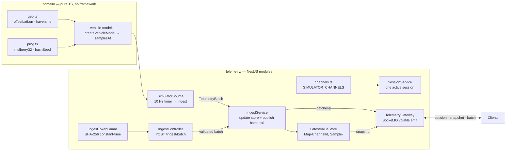

# Implementation Steps: Week 2 — Simulator and Ingest Pipeline

> **Source PRD**: [`.spec/Week 02 simulator ingest.md`](file:///Users/okrdima/My%20projects/SokilGCS/.spec/Week%2002%20simulator%20ingest.md)
>
> **Granularity**: Atomic — one checkbox per function, file, or verifiable action.
> Execute tasks in order within each phase. Phases are sequential unless noted.

---

## Glossary (terms used in this plan)

| Term | Meaning |
| --- | --- |
| **Module** | Anything with an interface and an implementation (function, class, package). |
| **Seam** | A place where behaviour can be altered without editing in that place. |
| **Adapter** | A concrete thing that satisfies an interface at a seam. |
| **Depth** | Leverage at the interface — lots of behaviour behind a small surface. |
| **Source** | An adapter that satisfies the `TelemetrySource` interface to produce `TelemetryBatch` messages. |
| **Channel** | One named, typed, rated telemetry measurement (e.g. `battery.voltage`). |
| **Session** | One recording run: identifies the source, vehicle, start time, and available channels. |
| **Batch** | A group of `TelemetrySample[]` from one source, tagged with a `sessionId` and `sourceId`. |
| **Snapshot** | The latest sample of every channel that has received data. |
| **Store** | The `LatestValueStore` — an in-memory `Map<ChannelId, TelemetrySample>`. |
| **Ingest** | The single entry point that accepts a batch, updates the store, and publishes it. |

---

## Phase 0 — Prerequisites & Environment Setup

> Goal: a clean build, type-check, lint, and test runner in the backend.

### 0.1 — Fix workspace resolution

- [ ] **0.1.1** Remove `paths` entries from [`apps/backend/tsconfig.json`](file:///Users/okrdima/My%20projects/SokilGCS/apps/backend/tsconfig.json) that point at `../packages/contracts/dist`. Rely on pnpm workspace resolution (`"@sokil/contracts": "workspace:*"` in `package.json`).
- [ ] **0.1.2** Run `pnpm --filter @sokil/contracts build` and then `pnpm --filter @sokil/backend check-types` — must pass with zero errors.

### 0.2 — Jest setup

- [ ] **0.2.1** Create [`apps/backend/jest.config.ts`](file:///Users/okrdima/My%20projects/SokilGCS/apps/backend/jest.config.ts): preset `ts-jest`, `rootDir: 'src'`, `testRegex: '.*\\.spec\\.ts$'`, `moduleNameMapper` for `@sokil/contracts`.
- [ ] **0.2.2** Add `"test": "jest"` and `"test:e2e": "jest --config jest-e2e.config.ts"` scripts to [`apps/backend/package.json`](file:///Users/okrdima/My%20projects/SokilGCS/apps/backend/package.json).
- [ ] **0.2.3** Create a trivial smoke test (e.g. `src/app.controller.spec.ts` if not already working) and verify `pnpm --filter @sokil/backend test` exits green.

### 0.3 — Zod version alignment

- [ ] **0.3.1** Run `pnpm why zod` — verify only one version resolves. If duplicates exist, align all packages to `^4.6.5` and run `pnpm install`.

### 0.4 — Add `socket.io-client`

- [ ] **0.4.1** `pnpm --filter @sokil/backend add -D socket.io-client`.

### 0.5 — Widen ESLint domain rule

- [ ] **0.5.1** In [`apps/backend/eslint.config.mjs`](file:///Users/okrdima/My%20projects/SokilGCS/apps/backend/eslint.config.mjs), change `files: ['src/domain/math/**/*.ts']` → `files: ['src/domain/**/*.ts']` for the `no-restricted-imports` rule. This ensures the vehicle model and any future domain code stay framework-free.
- [ ] **0.5.2** Run `pnpm --filter @sokil/backend lint` — must pass.

### 0.6 — `.env.example`

- [ ] **0.6.1** Create [`.env.example`](file:///Users/okrdima/My%20projects/SokilGCS/.env.example) at the repo root with all six variables:
  ```env
  PORT=3001
  WEB_ORIGIN=http://localhost:3000
  SIMULATOR_ENABLED=true
  SIMULATOR_SEED=42
  SIMULATOR_BATTERY_DRAIN_SECONDS=600
  INGEST_TOKEN=CHANGE_ME_BEFORE_USE
  ```

### 0.7 — Config module

- [ ] **0.7.1** Create `apps/backend/src/config/env.ts`: export an `EnvSchema` (Zod object) and a `validateEnv()` function that reads `process.env`, parses through the schema, and throws a readable message on failure.
- [ ] **0.7.2** The schema must contain: `PORT` (number, default 3000), `WEB_ORIGIN` (string, default `http://localhost:3000`), `SIMULATOR_ENABLED` (boolean, default `true`), `SIMULATOR_SEED` (number, default 42), `SIMULATOR_BATTERY_DRAIN_SECONDS` (number, default 600), `INGEST_TOKEN` (string, optional).

### Phase 0 — Verification gate

- [ ] **0.V** All pass: `pnpm --filter @sokil/backend check-types`, `pnpm --filter @sokil/backend lint`, `pnpm --filter @sokil/backend test`.

---

## Phase 1 — Math Core (pure functions, no framework imports)

> **Module design**: Two deep, pure-TS modules under `src/domain/math/`. No `@nestjs/*`, `rxjs`, Node I/O, `Math.random`, or `Date.now`. The seam is at the function signature; the depth is in the math.

### 1.1 — Geographic utilities

- [ ] **1.1.1** Create [`apps/backend/src/domain/math/geo.ts`](file:///Users/okrdima/My%20projects/SokilGCS/apps/backend/src/domain/math/geo.ts).
- [ ] **1.1.2** Implement `offsetLatLon(lat0: number, lon0: number, eastM: number, northM: number): { lat: number; lon: number }`. Spherical Earth, radius `6_371_008.8` m. Longitude scaling uses `cos(lat0)`.
- [ ] **1.1.3** Implement `haversineM(a: { lat: number; lon: number }, b: { lat: number; lon: number }): number`.
- [ ] **1.1.4** Create [`apps/backend/src/domain/math/geo.spec.ts`](file:///Users/okrdima/My%20projects/SokilGCS/apps/backend/src/domain/math/geo.spec.ts):
  - Offset 1000 m north → haversine ≈ 1000 m.
  - Offset 1000 m east → haversine ≈ 1000 m.
  - Round-trip: offset then haversine back to origin ≈ 0.
  - Equator vs high latitude: longitude offset shrinks with `cos(lat)`.

### 1.2 — Seeded PRNG

- [ ] **1.2.1** Create [`apps/backend/src/domain/math/prng.ts`](file:///Users/okrdima/My%20projects/SokilGCS/apps/backend/src/domain/math/prng.ts).
- [ ] **1.2.2** Implement `mulberry32(seed: number): () => number` — returns a generator producing values in `[0, 1)`.
- [ ] **1.2.3** Implement `hashSeed(...parts: Array<number | string>): number` — returns a 32-bit unsigned integer seed.
- [ ] **1.2.4** Create [`apps/backend/src/domain/math/prng.spec.ts`](file:///Users/okrdima/My%20projects/SokilGCS/apps/backend/src/domain/math/prng.spec.ts):
  - Same seed → same sequence (determinism).
  - Different seed → different sequence.
  - Values are in `[0, 1)` for 1000 calls.
  - `hashSeed("a", 1) !== hashSeed("b", 1)`.

### 1.3 — Barrel export

- [ ] **1.3.1** Create `apps/backend/src/domain/math/index.ts` re-exporting `geo.ts` and `prng.ts`.

### Phase 1 — Verification gate

- [ ] **1.V** `pnpm --filter @sokil/backend test -- --testPathPattern=domain/math` — all green. ESLint passes (no framework imports in `domain/`).

---

## Phase 2 — Vehicle Model (deep, pure simulator module)

> **Module design**: `createVehicleModel(config)` returns a single-method object `{ samplesAt(tickIndex, timestampMs): TelemetrySample[] }`. This is the **deepest module** in the system — circular motion, battery drain, multi-rate emission, and noise generation all hidden behind one function call. Pure function of its arguments; call order does not matter.

### 2.1 — Vehicle model implementation

- [ ] **2.1.1** Create [`apps/backend/src/domain/simulator/vehicle-model.ts`](file:///Users/okrdima/My%20projects/SokilGCS/apps/backend/src/domain/simulator/vehicle-model.ts).
- [ ] **2.1.2** Define `VehicleModelConfig` interface: `center: { lat: number; lon: number }` (default `34.2045, -118.1723`), `radiusM` (150), `speedMps` (4), `batteryStartV` (25.0), `batteryEndV` (20.8), `batteryDrainSeconds` (600), `seed` (42).
- [ ] **2.1.3** Implement `createVehicleModel(config: Partial<VehicleModelConfig>)`:
  - Merges config with defaults.
  - Returns `{ samplesAt(tickIndex: number, timestampMs: number): TelemetrySample[] }`.
- [ ] **2.1.4** Implement circular track math:
  - `t = tickIndex × 0.1 s`
  - `θ = (speed / radius) × t` (clockwise from north)
  - `east = r · sin(θ)`, `north = r · cos(θ)`
  - Position via `offsetLatLon(center, east, north)`
  - Heading `= (θ_degrees + 90) % 360`
- [ ] **2.1.5** Implement linear battery drain:
  - `voltage = startV - (startV - endV) × min(t / drainSeconds, 1)`
  - Current: `18.6 ± 0.5` (noise from PRNG).
- [ ] **2.1.6** Implement noise injection:
  - For each `(seed, channelId, tickIndex)` → deterministic noise via `hashSeed` + `mulberry32`.
  - Result is independent of call order.
  - Each channel has a fixed noise amplitude (see channel catalog).
- [ ] **2.1.7** Implement multi-rate emission:
  - 10 Hz channels: every tick.
  - 5 Hz channels: every 2nd tick (`tickIndex % 2 === 0`).
  - 2 Hz channels: every 5th tick (`tickIndex % 5 === 0`).
  - 1 Hz channels: every 10th tick (`tickIndex % 10 === 0`).
  - Every tick produces at least one sample.
- [ ] **2.1.8** Ensure all returned values are finite numbers and satisfy `valueType: 'NUMBER'`.

### 2.2 — Vehicle model barrel

- [ ] **2.2.1** Create `apps/backend/src/domain/simulator/index.ts` re-exporting `vehicle-model.ts`.

### 2.3 — Vehicle model tests

- [ ] **2.3.1** Create [`apps/backend/src/domain/simulator/vehicle-model.spec.ts`](file:///Users/okrdima/My%20projects/SokilGCS/apps/backend/src/domain/simulator/vehicle-model.spec.ts).
- [ ] **2.3.2** Test: distance from center equals radius (within 0.5 m) for 100 ticks.
- [ ] **2.3.3** Test: after one full lap (`2π × radius / speed × 10` ticks), position returns to start (within 0.5 m). One lap ≈ 235.6 s ≈ 2356 ticks.
- [ ] **2.3.4** Test: heading is tangent to the circle (perpendicular to the radius vector).
- [ ] **2.3.5** Test: same seed → identical output for the same `tickIndex`.
- [ ] **2.3.6** Test: battery voltage at tick 0 is `≈ 25.0 V`; 10 s later (tick 100) it is lower.
- [ ] **2.3.7** Test: battery voltage at tick `5430` (543 s) ≈ `21.2 V` (red limit).
- [ ] **2.3.8** Test: all channel IDs pass `ChannelIdSchema`.
- [ ] **2.3.9** Test: channel rates match FR-M6 — at tick 0 all 9 channels emit; at tick 1 only 10 Hz channels emit; at tick 2, 10 Hz and 5 Hz emit; etc.
- [ ] **2.3.10** Test: `gps.satellites` value is always an integer.

### Phase 2 — Verification gate

- [ ] **2.V** `pnpm --filter @sokil/backend test -- --testPathPattern=domain/simulator` — all green. ESLint passes (no framework imports).

---

## Phase 3 — Telemetry Core (state & ingestion)

> **Module design**: Three modules behind the `telemetry/` seam.
> - `LatestValueStore` — deep: a lot of timestamp-comparison logic behind `update()` + `snapshot()`.
> - `IngestService` — thin adapter: glues the store to the `batches$` observable. Deliberately shallow, because the depth lives in the store and the source.
> - `SessionService` — holds at most one `Session`. No persistence, no multi-session logic.

### 3.1 — Channel catalog

- [ ] **3.1.1** Create [`apps/backend/src/telemetry/channels.ts`](file:///Users/okrdima/My%20projects/SokilGCS/apps/backend/src/telemetry/channels.ts).
- [ ] **3.1.2** Define `SIMULATOR_CHANNELS: ChannelDefinition[]` with all 9 channels from the PRD table (FR-C1): `position.lat`, `position.lon`, `nav.groundspeed`, `nav.heading`, `battery.voltage`, `battery.current`, `gps.satellites`, `gps.hdop`, `link.rssi`.
- [ ] **3.1.3** Each channel entry includes: `id`, `name`, `valueType: 'NUMBER'`, `unit`, `nominalRateHz`, and `limits` (where applicable).
- [ ] **3.1.4** At module load, validate every entry with `ChannelDefinitionSchema.parse()`. An invalid entry must throw and prevent startup.

### 3.2 — Session service

- [ ] **3.2.1** Create [`apps/backend/src/telemetry/session.service.ts`](file:///Users/okrdima/My%20projects/SokilGCS/apps/backend/src/telemetry/session.service.ts).
- [ ] **3.2.2** `@Injectable()` NestJS service.
- [ ] **3.2.3** `getActive(): Session | null` — returns the single active session or `null`.
- [ ] **3.2.4** `createSimulatorSession(): Session` — generates UUID, name `"Simulator run <ISO time>"`, `sourceKind: 'SIMULATOR'`, `vehicleKind: 'ROVER'`, `startedAt: Date.now()`, `channels: SIMULATOR_CHANNELS`. Validates with `SessionSchema.parse()`.
- [ ] **3.2.5** The service holds at most one active session in memory.

### 3.3 — Latest-value store

- [ ] **3.3.1** Create [`apps/backend/src/telemetry/latest-values.store.ts`](file:///Users/okrdima/My%20projects/SokilGCS/apps/backend/src/telemetry/latest-values.store.ts).
- [ ] **3.3.2** `@Injectable()` NestJS service.
- [ ] **3.3.3** Internal state: `private store = new Map<ChannelId, TelemetrySample>()`.
- [ ] **3.3.4** `update(batch: TelemetryBatch): void`:
  - For each sample: if no stored value or `sample.t >= stored.t`, replace.
  - A sample with `sample.t < stored.t` is ignored in the store.
- [ ] **3.3.5** `snapshot(): TelemetrySample[]` — returns the latest sample of every channel.
- [ ] **3.3.6** Store size is bounded by the number of channels (never grows unbounded).

### 3.4 — Latest-value store tests

- [ ] **3.4.1** Create [`apps/backend/src/telemetry/latest-values.store.spec.ts`](file:///Users/okrdima/My%20projects/SokilGCS/apps/backend/src/telemetry/latest-values.store.spec.ts).
- [ ] **3.4.2** Test: `update` stores the newest sample per channel.
- [ ] **3.4.3** Test: `update` ignores samples with `t` older than the stored one.
- [ ] **3.4.4** Test: `update` replaces when `t` equals the stored one.
- [ ] **3.4.5** Test: `snapshot()` returns all channels that have received data.
- [ ] **3.4.6** Test: empty store → `snapshot()` returns `[]`.

### 3.5 — Ingest service

- [ ] **3.5.1** Create [`apps/backend/src/telemetry/ingest.service.ts`](file:///Users/okrdima/My%20projects/SokilGCS/apps/backend/src/telemetry/ingest.service.ts).
- [ ] **3.5.2** `@Injectable()` NestJS service, injecting `LatestValueStore`.
- [ ] **3.5.3** `readonly batches$ = new Subject<TelemetryBatch>()` — no replay buffer.
- [ ] **3.5.4** `ingest(batch: TelemetryBatch): void` — calls `store.update(batch)`, then `batches$.next(batch)`.

### 3.6 — Ingest service tests

- [ ] **3.6.1** Create [`apps/backend/src/telemetry/ingest.service.spec.ts`](file:///Users/okrdima/My%20projects/SokilGCS/apps/backend/src/telemetry/ingest.service.spec.ts).
- [ ] **3.6.2** Test: `ingest` calls `store.update` with the batch.
- [ ] **3.6.3** Test: `ingest` publishes every batch on `batches$`, even when the store ignores a sample (older `t`).
- [ ] **3.6.4** Test: `batches$` is a Subject with no replay — a late subscriber misses earlier batches.

### Phase 3 — Verification gate

- [ ] **3.V** `pnpm --filter @sokil/backend test -- --testPathPattern=telemetry` — store and ingest tests green.

---

## Phase 4 — Simulator Source & Wiring

> **Module design**: `SimulatorSource` is an **adapter** at the `TelemetrySource` seam. It adapts the pure vehicle model into a ticking NestJS lifecycle participant. The depth of the physics is in the model; the source is a thin scheduling shell.

### 4.1 — TelemetrySource interface

- [ ] **4.1.1** Create [`apps/backend/src/telemetry/sources/telemetry-source.ts`](file:///Users/okrdima/My%20projects/SokilGCS/apps/backend/src/telemetry/sources/telemetry-source.ts).
- [ ] **4.1.2** Define `interface TelemetrySource { id: string; start(): void; stop(): void; }`.

### 4.2 — SimulatorSource

- [ ] **4.2.1** Create [`apps/backend/src/telemetry/sources/simulator.source.ts`](file:///Users/okrdima/My%20projects/SokilGCS/apps/backend/src/telemetry/sources/simulator.source.ts).
- [ ] **4.2.2** `@Injectable()`, implements `TelemetrySource`, `OnModuleInit`, `OnModuleDestroy`.
- [ ] **4.2.3** Inject `IngestService`, `SessionService`, and the validated env config.
- [ ] **4.2.4** `id = 'simulator'`.
- [ ] **4.2.5** On `onModuleInit()`: if `SIMULATOR_ENABLED`, create the session via `SessionService`, create the vehicle model, and call `start()`.
- [ ] **4.2.6** `start()`: record `startMs = Date.now()`. Schedule tick `n` for `startMs + n × 100` using `setTimeout`. After each callback, schedule the next tick with drift correction: `delay = (startMs + (n+1) × 100) - Date.now()`.
- [ ] **4.2.7** Each tick: call `model.samplesAt(tickIndex, scheduledTimestampMs)`, wrap the returned samples into a `TelemetryBatch` with `sessionId` and `sourceId: 'simulator'`, and call `ingestService.ingest(batch)`.
- [ ] **4.2.8** The sample time `t` in each sample is the **scheduled** time, not `Date.now()`.
- [ ] **4.2.9** `stop()`: clear the pending timeout. Set a flag so no more ticks are scheduled.
- [ ] **4.2.10** `onModuleDestroy()`: call `stop()`.

### 4.3 — Telemetry module

- [ ] **4.3.1** Create [`apps/backend/src/telemetry/telemetry.module.ts`](file:///Users/okrdima/My%20projects/SokilGCS/apps/backend/src/telemetry/telemetry.module.ts).
- [ ] **4.3.2** Register providers: `SessionService`, `LatestValueStore`, `IngestService`, `SimulatorSource`.
- [ ] **4.3.3** Export `IngestService`, `SessionService`, `LatestValueStore` (needed by the gateway and controller).

### 4.4 — Wire into AppModule

- [ ] **4.4.1** Import `TelemetryModule` in [`apps/backend/src/app.module.ts`](file:///Users/okrdima/My%20projects/SokilGCS/apps/backend/src/app.module.ts).

### 4.5 — Update `main.ts`

- [ ] **4.5.1** In [`apps/backend/src/main.ts`](file:///Users/okrdima/My%20projects/SokilGCS/apps/backend/src/main.ts): call `validateEnv()` before `NestFactory.create()`. Use the validated `PORT`. Replace `console.log` with NestJS `Logger`.

### 4.6 — Logging

- [ ] **4.6.1** In `SimulatorSource`: log session start (info), batches-per-second counter every 10 s (debug).
- [ ] **4.6.2** Use `Logger` from `@nestjs/common` everywhere. No `console.log` in `src/`.

### Phase 4 — Verification gate

- [ ] **4.V.1** Start the backend (`pnpm --filter @sokil/backend dev`). Console shows session creation and 10 batches/s logged.
- [ ] **4.V.2** Stop the backend — no "open handles" warning, clean shutdown (AC-10).

---

## Phase 5 — HTTP Ingest Endpoint

> **Module design**: The HTTP boundary is a thin **adapter** at the edge. Validation (Zod schema) + authentication (token guard) + semantic checks happen here. Once past the boundary, data enters `IngestService` without re-validation.

### 5.1 — Backend-side DTO

- [ ] **5.1.1** Create [`apps/backend/src/telemetry/dto/telemetry-batch.dto.ts`](file:///Users/okrdima/My%20projects/SokilGCS/apps/backend/src/telemetry/dto/telemetry-batch.dto.ts).
- [ ] **5.1.2** Define a `createZodDto` class wrapping `TelemetryBatchSchema` from `@sokil/contracts`. This enables the NestJS validation pipe.

### 5.2 — Ingest token guard

- [ ] **5.2.1** Create [`apps/backend/src/telemetry/ingest-token.guard.ts`](file:///Users/okrdima/My%20projects/SokilGCS/apps/backend/src/telemetry/ingest-token.guard.ts).
- [ ] **5.2.2** `@Injectable()` implementing `CanActivate`.
- [ ] **5.2.3** If `INGEST_TOKEN` is not configured: log a warning at startup, return `false` (503).
- [ ] **5.2.4** Read `x-api-key` from request headers.
- [ ] **5.2.5** Compare in constant time: SHA-256 hash both values, then `crypto.timingSafeEqual()`. Never log the token.
- [ ] **5.2.6** Missing or wrong token → throw `UnauthorizedException` (401).

### 5.3 — Ingest token guard tests

- [ ] **5.3.1** Create [`apps/backend/src/telemetry/ingest-token.guard.spec.ts`](file:///Users/okrdima/My%20projects/SokilGCS/apps/backend/src/telemetry/ingest-token.guard.spec.ts).
- [ ] **5.3.2** Test: correct token → passes.
- [ ] **5.3.3** Test: wrong token → 401.
- [ ] **5.3.4** Test: missing `x-api-key` header → 401.
- [ ] **5.3.5** Test: different-length token → 401 (no timing leak).
- [ ] **5.3.6** Test: no `INGEST_TOKEN` configured → 503.

### 5.4 — Ingest controller

- [ ] **5.4.1** Create [`apps/backend/src/telemetry/ingest.controller.ts`](file:///Users/okrdima/My%20projects/SokilGCS/apps/backend/src/telemetry/ingest.controller.ts).
- [ ] **5.4.2** `@Controller('ingest')`, `@UseGuards(IngestTokenGuard)` on the class or route.
- [ ] **5.4.3** `@Post('batch')` handler:
  - Body validated by `TelemetryBatchDto` (Zod pipe).
  - Semantic checks after schema validation:
    - `batch.sessionId` must equal the active session's ID → 404 if not.
    - Every `sample.channelId` must exist in the session's channels → 422 if unknown.
    - Every `sample.value` must match the channel's `valueType` → 422 if wrong type.
  - On success: call `ingestService.ingest(batch)`, return `{ accepted: batch.samples.length }` with 202.
- [ ] **5.4.4** Apply body size limit of 1 MB (NestJS `rawBody` limit or Express `json({ limit: '1mb' })` in `main.ts`).

### 5.5 — Register in module

- [ ] **5.5.1** Add `IngestController` and `IngestTokenGuard` to `TelemetryModule`.

### 5.6 — HTTP ingest e2e tests

- [ ] **5.6.1** Create [`apps/backend/src/telemetry/ingest.e2e-spec.ts`](file:///Users/okrdima/My%20projects/SokilGCS/apps/backend/src/telemetry/ingest.e2e-spec.ts) (or under a `test/` directory).
- [ ] **5.6.2** Test: valid batch + correct token → 202, body `{ accepted: N }`.
- [ ] **5.6.3** Test: missing required fields → 400 with `errors` array.
- [ ] **5.6.4** Test: missing token → 401.
- [ ] **5.6.5** Test: wrong token → 401.
- [ ] **5.6.6** Test: unknown `sessionId` → 404.
- [ ] **5.6.7** Test: body > 1 MB → 413.
- [ ] **5.6.8** Test: unknown `channelId` → 422.
- [ ] **5.6.9** Test: wrong `valueType` (string where NUMBER expected) → 422.
- [ ] **5.6.10** Test: no `INGEST_TOKEN` env → 503.

### Phase 5 — Verification gate

- [ ] **5.V** All HTTP endpoint tests pass. AC-6, AC-7, AC-8, AC-9 satisfied.

---

## Phase 6 — WebSocket Gateway

> **Module design**: The gateway is a thin **adapter** at the Socket.IO seam. It holds no per-client state beyond room membership. The depth of telemetry distribution lives in the `batches$` stream and the store.

### 6.1 — Telemetry gateway

- [ ] **6.1.1** Create [`apps/backend/src/telemetry/gateway/telemetry.gateway.ts`](file:///Users/okrdima/My%20projects/SokilGCS/apps/backend/src/telemetry/gateway/telemetry.gateway.ts).
- [ ] **6.1.2** `@WebSocketGateway({ cors: { origin: WEB_ORIGIN } })`.
- [ ] **6.1.3** Inject `SessionService`, `LatestValueStore`, `IngestService`.
- [ ] **6.1.4** `handleConnection(client: Socket)`:
  - Get active session. If `null`: emit `session` with `null`, return (no snapshot).
  - Emit `session` with the `Session` object (to that client only).
  - Emit `snapshot` with `{ sessionId, samples: store.snapshot() }` (to that client only).
  - Join client to room `session:<sessionId>`.
  - Log connection (info).
- [ ] **6.1.5** `handleDisconnect(client: Socket)`: log disconnection (info).
- [ ] **6.1.6** `afterInit()`: subscribe to `ingestService.batches$`. On each batch, `volatile` emit `batch` to room `session:<batch.sessionId>`.
- [ ] **6.1.7** No per-client state beyond room membership.

### 6.2 — Register gateway

- [ ] **6.2.1** Add `TelemetryGateway` to `TelemetryModule` providers.

### 6.3 — Session HTTP endpoint (should-have)

- [ ] **6.3.1** Add `GET /sessions/active` to a controller (can be `SessionController` or add to an existing one). Returns the active session as JSON, or 404.

### 6.4 — Health endpoint (should-have)

- [ ] **6.4.1** Add `GET /health` returning `{ status: "ok", simulator: "running" | "stopped" }`.

### 6.5 — WebSocket e2e tests

- [ ] **6.5.1** Create [`apps/backend/src/telemetry/telemetry.e2e-spec.ts`](file:///Users/okrdima/My%20projects/SokilGCS/apps/backend/src/telemetry/telemetry.e2e-spec.ts).
- [ ] **6.5.2** Test: on connect, events arrive in order `session` → `snapshot` → `batch` (AC-1).
- [ ] **6.5.3** Test: batch count over 2 s ≈ 20 (±2).
- [ ] **6.5.4** Test: client connecting 30 s after startup receives a snapshot with all 9 channels (AC-4).
- [ ] **6.5.5** Test: with no active session, `session` event carries `null` and no `snapshot` is sent.

### Phase 6 — Verification gate

- [ ] **6.V** WebSocket tests pass. Starting the backend and connecting with a test client shows `session` → `snapshot` → ~10 `batch`/s.

---

## Phase 7 — Observability Script

### 7.1 — `ws-listen.ts`

- [ ] **7.1.1** Create [`apps/backend/scripts/ws-listen.ts`](file:///Users/okrdima/My%20projects/SokilGCS/apps/backend/scripts/ws-listen.ts).
- [ ] **7.1.2** Connect to `http://localhost:${PORT || 3001}` using `socket.io-client`.
- [ ] **7.1.3** Print each event type (`session`, `snapshot`, `batch`) with a summary.
- [ ] **7.1.4** Print a batches-per-second counter every second.
- [ ] **7.1.5** Add a `"ws:listen"` script to `package.json`: `"ts-node scripts/ws-listen.ts"`.

### Phase 7 — Verification gate

- [ ] **7.V** Run backend + `ws-listen.ts` side-by-side. Output shows `session`, `snapshot`, then ~10 batch/s (AC-1).

---

## Phase 8 — Containerization & Deployment

### 8.1 — Dockerfile updates

- [ ] **8.1.1** In [`apps/backend/Dockerfile`](file:///Users/okrdima/My%20projects/SokilGCS/apps/backend/Dockerfile): verify the build stage runs `pnpm --filter @sokil/contracts build` before `pnpm --filter @sokil/backend build` (already present — confirm).
- [ ] **8.1.2** Create or update [`.dockerignore`](file:///Users/okrdima/My%20projects/SokilGCS/.dockerignore): exclude `node_modules`, `dist`, `.env`, `.git`.

### 8.2 — docker-compose.yml updates

- [ ] **8.2.1** In [`docker-compose.yml`](file:///Users/okrdima/My%20projects/SokilGCS/docker-compose.yml): change backend port binding from `"3001:3000"` to `"127.0.0.1:3001:3000"` (localhost-only, prevents external network access).
- [ ] **8.2.2** Add environment variables to the backend service: `PORT=3000`, `WEB_ORIGIN`, `SIMULATOR_ENABLED=true`, `SIMULATOR_SEED=42`, `SIMULATOR_BATTERY_DRAIN_SECONDS=600`. Remove `REDIS_HOST`, `REDIS_PORT`, `DATABASE_URL` (not needed this week).
- [ ] **8.2.3** Remove `depends_on: redis` and `depends_on: db` from the backend service (no database or Redis this week).

### 8.3 — Container verification

- [ ] **8.3.1** `docker compose --profile app up --build` starts the backend successfully.
- [ ] **8.3.2** `ws-listen.ts` against `localhost:3001` shows the same stream as local dev (AC-11).

### Phase 8 — Verification gate

- [ ] **8.V** Container runs, produces telemetry, `ws-listen.ts` works against it.

---

## Phase 9 — Final Polish & CI

### 9.1 — CI checks

- [ ] **9.1.1** `pnpm --filter @sokil/backend lint` — passes.
- [ ] **9.1.2** `pnpm --filter @sokil/backend check-types` — passes.
- [ ] **9.1.3** `pnpm --filter @sokil/backend test` — all unit tests pass.
- [ ] **9.1.4** `pnpm --filter @sokil/backend build` — builds successfully.
- [ ] **9.1.5** Verify: `domain/**` has no framework imports (`@nestjs`, `rxjs`).
- [ ] **9.1.6** Verify: no import cycles (use `madge` or manual check).
- [ ] **9.1.7** Verify: no `console.log` in `src/` (only `Logger`).

### 9.2 — Documentation updates

- [ ] **9.2.1** Update `README.md` with new environment variables and how to run the simulator.
- [ ] **9.2.2** Update `docs/ROADMAP.md` — Docker bullet no longer mentions database requirement.

### 9.3 — Demo

- [ ] **9.3.1** Save a terminal capture or recording of `ws-listen.ts` showing live telemetry for the portfolio.

### Phase 9 — Verification gate (Definition of Done)

- [ ] **9.V.1** All **Must** requirements (FR-*) implemented.
- [ ] **9.V.2** AC-1 through AC-12 pass.
- [ ] **9.V.3** All tests from Section 9 of the PRD exist and pass.
- [ ] **9.V.4** `.env.example`, `README.md`, `docs/ROADMAP.md` updated.
- [ ] **9.V.5** CI is green on the pull request.

---

## Architecture Summary



## Seam Map

| Seam | Interface | Adapters this week |
| --- | --- | --- |
| `TelemetrySource` | `{ id, start(), stop() }` | `SimulatorSource` |
| `IngestService.ingest()` | `(batch: TelemetryBatch) => void` | Called by `SimulatorSource`, `IngestController` |
| `batches$` | `Observable<TelemetryBatch>` | Subscribed by `TelemetryGateway` |
| HTTP boundary | `POST /ingest/batch` | `IngestController` + `IngestTokenGuard` |
| WebSocket boundary | Socket.IO `/` namespace | `TelemetryGateway` |

## Estimated Effort

| Phase | Estimate |
| --- | --- |
| 0 — Prerequisites | 0.5–1 h |
| 1 — Math core | 1.5–2 h |
| 2 — Vehicle model | 3–4 h |
| 3 — Telemetry core | 2–3 h |
| 4 — Simulator source | 1.5–2 h |
| 5 — HTTP ingest | 2–3 h |
| 6 — WebSocket gateway | 2–3 h |
| 7 — ws-listen script | 0.5 h |
| 8 — Containerization | 1–2 h |
| 9 — Polish & CI | 1–2 h |
| **Total** | **15–22 h** |
