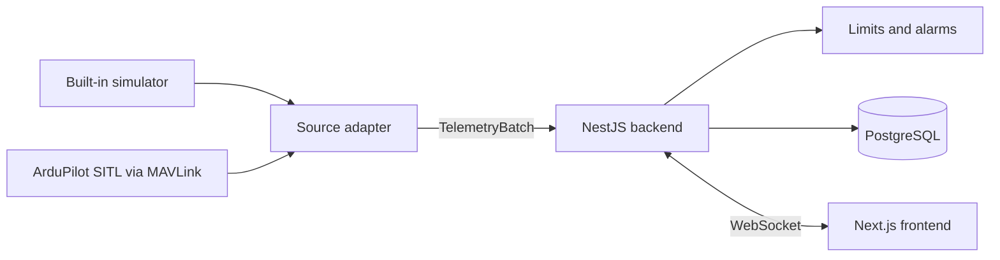

# SokilGCS

An open-source, vehicle-agnostic ground control and telemetry analysis platform, built with TypeScript.

> **Status: early development.** The foundation is in place (monorepo, shared contracts, quality gates). Live telemetry, recording and replay are in progress. See the [roadmap](docs/ROADMAP.md).
>
> **Safety notice:** SokilGCS is a learning and portfolio project. It is not certified and must not be used to control real vehicles. Weapons, targeting and engagement features are out of scope.

## Goal

Connect to a simulated vehicle, watch live telemetry on a map and instrument panels, send commands that are acknowledged, record the session, and replay it on a timeline. Everything runs locally with one command.

The telemetry model is vehicle-agnostic: the same channels, limits, alarms and commands should describe a multirotor, a fixed-wing aircraft or a planetary rover. Typical use cases are survey and inspection, search and rescue, education and simulation, and rover-style operations.

## v0.1 definition of done

- [ ] A built-in simulator and ArduPilot SITL feed the same telemetry pipeline
- [ ] The live instrument panel and map update in real time over WebSocket
- [ ] Channel limits (yellow and red) raise and clear alarms
- [ ] Commands move through `PENDING` → `SENT` → `ACKNOWLEDGED`, `REJECTED`, `FAILED` or `TIMED_OUT`
- [ ] Sessions are recorded to PostgreSQL and can be replayed on a timeline
- [ ] A second simulated source (a rover) works without changing the core
- [ ] Tests for contracts and domain logic, CI is green, and a demo video is in this README
- [ ] Stretch: mission waypoints can be planned, validated and uploaded

## Project status

| Area                                           | State         |
| ---------------------------------------------- | ------------- |
| Monorepo (Turborepo, pnpm) and shared config   | Done          |
| Lint, type-check and format gates              | Done          |
| Contracts: schemas for each domain             | Scaffolded    |
| Backend: drone module with Zod validation      | Scaffolded    |
| Frontend                                       | Starter only  |
| Telemetry pipeline and simulator               | Planned       |
| MAVLink adapter (ArduPilot SITL)               | Planned       |
| Live instrument panel and map                  | Planned       |
| Limits, alarms and command lifecycle           | Planned       |
| Recording (PostgreSQL) and timeline replay     | Planned       |
| Mission planner                                | Stretch goal  |

## Architecture



### Prerequisites
- **Node.js:** `>=18.0.0`
- **Package Manager:** `pnpm` (`>=8.0.0`)

### Core Stack
- **Monorepo Manager:** [Turborepo](https://turbo.build/) + `pnpm` workspaces
- **Frontend:** [Next.js](https://nextjs.org/) / React (App Router, Tailwind CSS, Leaflet/Mapbox)
- **Backend:** [NestJS](https://nestjs.com/) (WebSocket Gateway, MAVLink/Telemetry processing pipeline)
- **Shared Contracts:** TypeScript (`@sokil/contracts`)

Design principles:

- **Contracts are the single source of truth.** Zod schemas in `@sokil/contracts` define every message shared by the backend and the frontend.
- **Validate at the boundaries.** Adapter output, commands and uploads are validated once. Inside the backend and over the WebSocket, typed data is passed on without re-validating every sample.
- **One-way dependencies.** Domains depend on each other in one direction only, and ESLint rejects import cycles.

## Repository layout
```text
.
├── .opencode/           # Agent orchestration configs & spec checkers
├── .spec/               # Technical specifications & ACs
├── apps/
│   ├── gcs-frontend/             # Next.js Ground Control Station dashboard
│   └── backend/             # NestJS telemetry & mission control gateway and WebSocket gateway
└── packages/
    ├── contracts/       # @sokil/contracts (DDD domain DTOs, types, barrels), Zod schemas and shared types
    ├── config/          # Shared tsconfig, ESLint and Prettier configuratio
```

### Domain Boundaries (`packages/contracts`)
The core domain model is separated into 6 explicit sub-domains:
1. `shared/` — Primitive spatial vectors (`Vector3D`, `GeoPoint`), Euler angles, and unit utilities.
2. `drone/` — Vehicle connection state, heartbeats, flight modes, and execution commands.
3. `telemetry/` — High-frequency streaming frames, time-series data structures, and log playback indices.
4. `mission/` — Flight plans, waypoints, geofences, and rally point structures.
5. `map/` — Tile layer configurations, spatial overlays, and GIS metadata.
6. `events/` — Critical system alerts, warnings (`FAILSAFE_RTL`, `LOW_BATTERY`), and hardware status logs.


## Getting started

Prerequisites:

- Node.js 20.11 or newer
- pnpm 12 (the exact version is pinned in `packageManager`)
- Docker, for local services

```bash
git clone https://github.com/okrdima/SokilGCS.git
cd SokilGCS
pnpm install
cp .env.example .env
pnpm db:up
pnpm dev
```

`pnpm dev` runs lint first and then starts the backend, the frontend and the contracts watcher.

## Scripts

| Command                         | What it does                                      |
| ------------------------------- | ------------------------------------------------- |
| `pnpm dev`                      | Lint, then start every app in watch mode          |
| `pnpm dev:backend`              | Same, for the backend only                        |
| `pnpm dev:frontend`             | Same, for the frontend only                       |
| `pnpm build`                    | Lint, then build every package                    |
| `pnpm lint`                     | ESLint across the workspace                       |
| `pnpm check-types`              | TypeScript type check across the workspace        |
| `pnpm format` / `format:check`  | Prettier write / check                            |
| `pnpm db:up` / `pnpm db:down`   | Start / stop local services (Docker Compose)      |

## Quality gates

- Turborepo runs `lint` before `build` and `dev`, so lint errors stop the build.
- ESLint rejects import cycles (`import-x/no-cycle`) and a package importing itself.
- Inside `@sokil/contracts`, import specific files by relative path or the `@/` alias, never through a folder's `index.ts`.
- Prettier formats on save in the editor and can be checked with `pnpm format:check`.

## Roadmap

The plan is eight weeks of small, testable steps, from the telemetry contracts to a recorded and replayable session. After v0.1 the plan continues with contributions to open-source mission control software. See [docs/ROADMAP.md](docs/ROADMAP.md).

## License

MIT. See [LICENSE](LICENSE).
